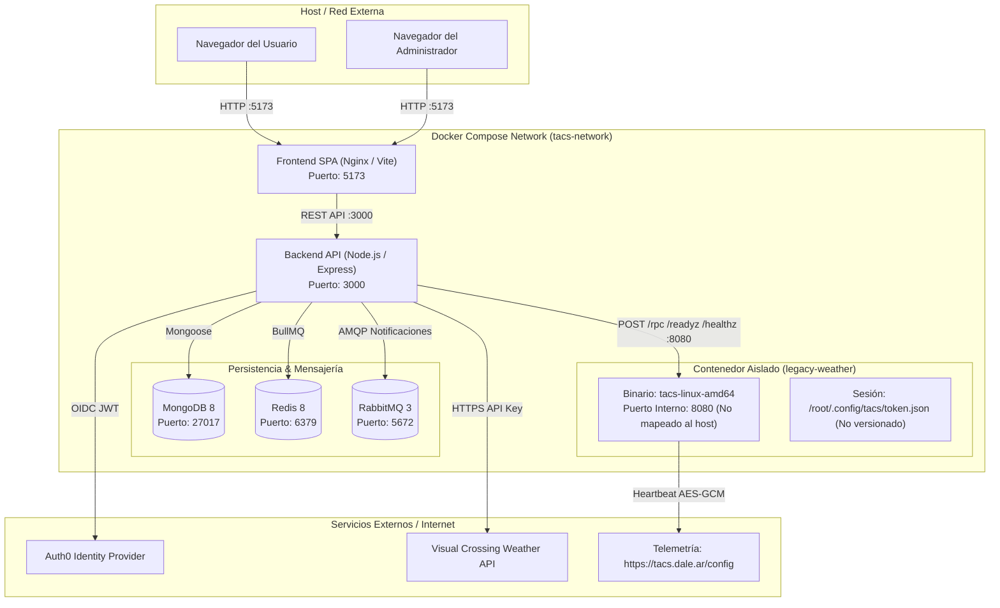

# TP TACS 2026-C2 — Entrega 4: Proveedor de Clima Legacy

Este documento detalla la integración, arquitectura de resiliencia, hallazgos de ingeniería inversa y procedimientos operativos para el proveedor de clima legacy (**Humedad, Datos y Pronósticos S.A.**) en **404 Sol Not Found**.

---

## 1. Puesta en Marcha del Entorno Completo

### Prerrequisitos
- Docker Engine v20.10+ y Docker Compose v2.0+.
- Cuenta institucional de UTN FRBA (`@frba.utn.edu.ar`).
- Clave de API de Visual Crossing (para el proveedor estándar en `VISUAL_CROSSING_API_KEY`).

### Levantar el Entorno con Docker Compose

Desde la raíz del repositorio:

```bash
docker compose up -d --build
```

Esto levantará los siguientes servicios en una red interna compartida:
- **`tacs-frontend`**: Interfaz de usuario (React / Vite) expuesta en `http://localhost:5173`.
- **`tacs-backend`**: API REST (Node.js / Express) expuesta en `http://localhost:3000`.
- **`tacs-legacy-weather`**: Binario legacy (`tacs-linux-amd64`) corriendo en contenedor Linux en el puerto interno `:8080` (sin exposición pública al host).
- **`tacs-mongo`**: Base de datos MongoDB en `localhost:27018` (interno `:27017`).
- **`redis`**: Instancia de Redis para colas y caché en `:6379`.
- **`rabbitmq`**: Broker de mensajería para notificaciones en `:5672` (Management UI en `:15672`).

### Autenticación del Servicio Legacy

El binario legacy gestiona su autenticación mediante Google OIDC para validar pertenencia a la organización `@frba.utn.edu.ar`.
1. **Configuración por Archivo y Volumen Docker**: Las credenciales de sesión se almacenan en formato JSON en el archivo `token.json` (ubicado por convención de Go en `/root/.config/tacs/token.json`). En `docker-compose.yml`, este archivo se monta directamente mediante un volumen hacia el contenedor:
   ```yaml
   volumes:
     - ./legacy-weather/token.json:/root/.config/tacs/token.json
   ```
   Esto permite que el binario restaure de inmediato la sesión institucional de forma automática al iniciar (`✓ session restored · fnegri@frba.utn.edu.ar`).
2. **Flujo Interactivo / Autónomo**: Si no se monta el archivo, el binario expone el enlace de login OIDC en consola y administra de forma autónoma su sesión.
3. El archivo `token.json` y los tokens generados se encuentran debidamente ignorados en Git (`.gitignore` y `.dockerignore`) para prevenir cualquier fuga de credenciales.

---

## 2. Fallas Descubiertas en el Binario Legacy

A partir de la descompilación y análisis estático con `iced-x86` y la inspección en runtime, se descubrieron los siguientes comportamientos problemáticos del binario:

| Comportamiento Problemático | Detección / Evidencia en el Binario | Impacto | Mitigación Implementada |
|---|---|---|---|
| **Motor de Caos Embebido (`rollDice`)** | Función `main.rollDice` en el binario: ejecuta un ticker cada 45 segundos con 10% probabilidad de `outage` (503) y 15% de `degraded`. | El servicio responde aleatoriamente con HTTP 503 o cortes abruptos sin previo aviso. | **Circuit Breaker** (abre a los 5 fallos evitando cascada) y **Fallback automático** transparente hacia Visual Crossing. |
| **Dependencia de Token OIDC Institucional** | Función `main.authenticate`: valida claims del token mediante `google.golang.org/api/idtoken` exigiendo `claims["hd"] == "frba.utn.edu.ar"`. | Si el token expira o no pertenece al dominio, devuelve HTTP 403 Forbidden. | Validación de códigos 401/403 sin reintento inútil; reenvío inmediato a fallback para no bloquear al usuario. |
| **Telemetría y Heartbeat Cifrado** | Función `main.startAnalytics`: cifra eventos cada 30s con AES-256-GCM usando la clave privada embebida en `.noptrdata` y hace POST a `https://tacs.dale.ar/config`. | Si la red bloquea la salida a internet hacia el endpoint de analytics, el binario acumula buffers en memoria (`eventsBuffer`). | Control de volumen y monitoreo con healthcheck en `/healthz` y `/readyz`. |
| **Contrato JSON-RPC Rígido** | Función `main.forecastRPC`: solo acepta `POST /rpc` con método `"weather.forecast"`. No soporta rangos de fechas ni métodos REST. | No es posible solicitar pronóstico horario multidiario en una sola llamada. | El adaptador (`LegacyWeatherAdapter`) traduce peticiones de rango en consultas horarias con concurrencia acotada (4 simultáneas) y caché local de 10m. |
| **Potencial Retorno de Datos Inválidos o Fuera de Rango** | Estructuras de respuesta `forecastResult` generadas por generadores determinísticos o mocks internos. | Respuestas con HTTP 200 que pueden contener valores numéricos fuera de rango físico (temperaturas absurdas o NaN). | **Validación estricta con Zod**: se valida que temperatura esté en [-60, 60]°C, humedad en [0, 100]%, viento >= 0. Ante fallo, se cataloga como `WEATHER_INVALID_RESPONSE`. |
| **Caídas Inesperadas del Proceso** | Si el proceso Go recibe señales o encuentra fallos fatales, termina con exit code 1. | Inaccesibilidad total del servicio de clima legacy. | Directiva Docker `restart: unless-stopped` que levanta automáticamente el contenedor en segundos sin intervención humana. |

---

## 3. Arquitectura y Técnicas de Resiliencia (ADRs)

Las decisiones de arquitectura y la justificación de cada técnica se encuentran registradas en [ADR 0005](adr/0005-integracion-resiliente-proveedor-clima-legacy.md).

### Resumen de Parámetros Elegidos

- **Timeouts:** 3.000 ms en todas las llamadas salientes con `AbortController`.
- **Reintentos:** 2 reintentos con backoff exponencial (`baseDelay = 150ms`, `maxDelay = 1200ms`) y Jitter aleatorio. Solo para fallos transitorios (5xx, red, timeout).
- **Circuit Breaker:** Umbral de fallo de 5 errores consecutivos -> `OPEN`. Tiempo de cooldown de 30 segundos -> `HALF_OPEN`. 2 éxitos en `HALF_OPEN` -> `CLOSED`.
- **Caché:** En memoria con TTL de 10 minutos indexada por lat/lon/hora. Absorbe ráfagas repetitivas.
- **Rate Limiting:** Token Bucket upstream a 10 peticiones/segundo para proteger al binario y 30 consultas/min por usuario.
- **Fallback:** Conmutación automática a Visual Crossing garantizando 100% de disponibilidad.

---

## 4. Diagrama de Despliegue con Servicio Legacy



---

## 5. Cuenta Institucional Utilizada

Para el flujo de autenticación y operación del servicio legacy:
- `fnegri@frba.utn.edu.ar`

---

## 6. Ejecución de Pruebas Automatizadas y Pruebas de Carga

### Tests de Resiliencia (con Stubs)
```bash
npm --prefix backend test tests/resilience/
```
Verifica unitariamente el Circuit Breaker, Retries con Jitter, Timeouts, Caché en memoria y Fallback sin requerir el binario real.

### Tests de Carga Reales (Load Testing con k6)
Las pruebas de carga se ejecutan mediante scripts de **Grafana k6** contra los contenedores reales levantados con `docker compose up -d` (requieren pasar `ACTIVIDAD_ID` y `AUTH_TOKEN`):
```bash
# Definir variables obligatorias
export ACTIVIDAD_ID="6adfab58e9f1720175168335"
export AUTH_TOKEN="<TU_TOKEN_JWT>"

# Escenario 1: Servicio legacy activo (evalúa latencias y caché en memoria)
k6 run -e ACTIVIDAD_ID=$ACTIVIDAD_ID -e AUTH_TOKEN=$AUTH_TOKEN load-tests/scenario-1-healthy.js

# Simular caída / degradación del servicio legacy
docker compose stop legacy-weather

# Escenario 2: Servicio legacy caído (evalúa 100% de 200 OK mediante Fallback y Circuit Breaker OPEN)
k6 run -e ACTIVIDAD_ID=$ACTIVIDAD_ID -e AUTH_TOKEN=$AUTH_TOKEN load-tests/scenario-2-outage.js

# O alternativamente mediante la imagen de Docker de k6 (sin instalación local):
docker run --rm -i --network=host grafana/k6 run -e ACTIVIDAD_ID=$ACTIVIDAD_ID -e AUTH_TOKEN=$AUTH_TOKEN - < load-tests/scenario-1-healthy.js
```
Para más detalles de configuración de umbrales y métricas, ver [`load-tests/README.md`](../load-tests/README.md).
